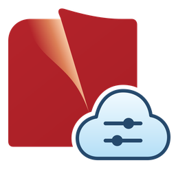

#  Sigenergy ESS – mySigen cloud

[![Release][releases-shield]][releases] [![License][license-shield]](LICENSE) [![Testers wanted][testers-shield]][testers]

[releases-shield]: https://img.shields.io/github/v/release/TypQxQ/Sigenergy-Local-Modbus-mySigen?include_prereleases
[releases]: https://github.com/TypQxQ/Sigenergy-Local-Modbus-mySigen/releases
[license-shield]: https://img.shields.io/github/license/TypQxQ/Sigenergy-Local-Modbus-mySigen.svg
[testers-shield]: https://img.shields.io/badge/testers-wanted-orange
[testers]: https://github.com/TypQxQ/Sigenergy-Local-Modbus-mySigen/discussions/20

**Control your Sigenergy battery from Home Assistant without Remote EMS.** Sigen AI stays in charge and Modbus can stay read-only. This add-on for [Sigenergy ESS](https://github.com/TypQxQ/Sigenergy-Local-Modbus) talks to mySigen, the same way the app does.

- 🔋 **Battery overrides:** hold, charge or discharge for up to two hours, ending by themselves.
- ⚙️ **Plant settings:** operating mode, battery export and peak shaving.
- 🔌 **Off-grid:** run the home on battery and solar.
- 🚗 **DC charger:** charging mode, stop level and V2X.
- 📈 **Gateway:** grid voltage and current per phase.

> **Beta, testers wanted.** [Tell us how it runs on your system →](https://github.com/TypQxQ/Sigenergy-Local-Modbus-mySigen/discussions/20)

## Install

Needs Home Assistant 2026.11+ and [Sigenergy ESS](https://github.com/TypQxQ/Sigenergy-Local-Modbus) 2.0.3+ with a plant set up.

1. Click the button to add this repository to the Marketplace. Until it is listed in the catalog, it is added as a custom repository, which needs a GitHub connection.
2. Install **Sigenergy ESS – mySigen cloud**. Releases are betas for now, so you may have to enable prereleases.
3. Restart if Home Assistant asks.

Or install it by hand: extract `sigen_mysigen.zip` from a [release](https://github.com/TypQxQ/Sigenergy-Local-Modbus-mySigen/releases) into `config/custom_components/sigen_mysigen/` and restart.

## Set up

1. In the mySigen app, share your system with a **new** email address, with **View and Edit** access. Using your own app account here can sign the app out.
2. **Settings → Devices & services → Add integration → Sigenergy ESS – mySigen cloud.** Pick the plant and enter the new account.
3. To control anything, open **Reconfigure** and switch on **Allow battery control**, then enable the controls you want.

Every change is checked first, sent once, and only counts when the plant shows it.

## More

- [Full guide](docs/USAGE.md): every entity and control, automations, safety checks, troubleshooting.
- [Roadmap](docs/PLAN.md)
- [Testers wanted](https://github.com/TypQxQ/Sigenergy-Local-Modbus-mySigen/discussions/20) · [Issues](https://github.com/TypQxQ/Sigenergy-Local-Modbus-mySigen/issues)

Unofficial and not affiliated with Sigenergy. It uses mySigen's private interface, which can change at any time. MIT licensed; request formats follow [solidfox/sigenergy-cloud](https://github.com/solidfox/sigenergy-cloud).
