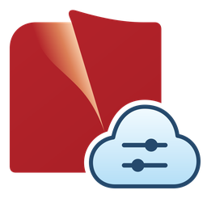

# Roadmap

**What works today, what needs your help, and what comes next.**

Updated 22 November 2026 · version 0.1.2b2

---

## ✅ Working and tested

| | Feature | What you get |
| :-: | --- | --- |
| 🔋 | **Battery overrides** | Hold, charge, discharge or self-consumption for 1 min to 24 h, with an optional power limit |
| ⚙️ | **Operating mode** | Sigen AI, self-consumption, time of use, or full feed-in |
| ↗️ | **Battery export** | Allow or block the battery sending power to the grid |
| 📉 | **Peak shaving** | On or off, and the grid limit to stay under |
| 📈 | **Gateway readings** | Grid voltage and current per phase, peaks and dips, phase order |
| 🔋 | **Battery modules** | Charge level, power, cell temperature and voltage, lifetime discharge, model and rated capacity per module |
| 🔌 | **Disconnect from the grid** | Off the grid and back on again, with a Gateway |
| 🌍 | **Eleven languages** | Following the plant's entity name language |

Tested on a few plants in Europe and Australia, all with a Gateway, one with a DC charger.

## 🧪 Working, needs testers

| | Feature | What is missing |
| :-: | --- | --- |
| 🚗 | **DC charger** | Charging mode, battery boost and its cut-off are confirmed on one charger and V2X reads correctly; the charge limit, V2X minimum and V2X switch still need a charger |
| 🔋 | **AC charger** | Charging mode, battery boost, cut-off and session energy read correctly on two chargers; no change has been sent from Home Assistant yet |
| 💡 | **Smart loads** | On/off switches for SigenStor and Gateway ports; switched on one plant only |
| 🎯 | **Sigen AI strategy preference** | Profit Max, Balanced Energy or Self-use First; tried on one plant only |
| 🏖️ | **Sigen AI vacation mode** | A switch, as in the app; switched on one plant only |
| 🌪️ | **Storm Watch** | An alert sensor; no plant with Storm Watch has been read yet |
| ☀️ | **PV string names** | The app's names on the PV string devices; tried on one plant only |
| 🗺️ | **Other systems** | Other regions, models, firmware, and systems without a Gateway |
| 🗣️ | **Translations** | Nine of the eleven languages need a native speaker |

> [!TIP]
> **Have one of these?** [Join the test →](https://github.com/TypQxQ/Sigenergy-Local-Modbus-mySigen/discussions/38) Even a diagnostics file helps, before you change anything.

## 📋 Planned

Nothing right now. The AC charger moved to testing in 0.1.2b1. Session duration and per-phase charger values are not in mySigen's answers.

## 💭 Not planned yet

Ideas that need more information about how mySigen handles them:

`charging schedules` · `timed V2X sessions` · `Sigen AI forecast` · `charger firmware`

## 🚫 Won't be added

| Feature | Why |
| --- | --- |
| Choosing solar or grid first for an override | mySigen's override has no such option. Use the Remote EMS modes in Sigenergy ESS. |
| Price windows | Dropped |
| Reactive power, power factor, per-phase setpoints | mySigen has no way to set them |
| Anything Sigenergy ESS already does | No duplicates: Modbus keeps power and energy readings, grid frequency and state, power limits, backup levels, charger start and stop, and alarms |

---

[Install](../README.md#install) · [Full guide](USAGE.md) · [Join the test](https://github.com/TypQxQ/Sigenergy-Local-Modbus-mySigen/discussions/38) · [Report a problem](https://github.com/TypQxQ/Sigenergy-Local-Modbus-mySigen/issues)

