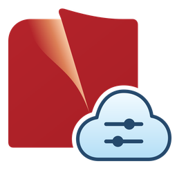

<div align="center">



# The full guide

**Every entity and control, and how each change is checked.**<br>
New here? Start with the [README](../README.md).

📊 [Entities](#-entities) · 🔋 [Modules](#-battery-modules) · 🔋 [Overrides](#-battery-overrides) · ⚙️ [Settings](#️-settings-that-stay) · 🔌 [Off-grid](#-disconnecting-from-the-grid) · 🚗 [DC charger](#-dc-charger) · 🔋 [AC charger](#-ac-charger) · 💡 [Smart loads](#-smart-loads) · ☀️ [PV names](#️-pv-string-names) · 🛡️ [Safety](#️-how-changes-are-checked) · 🩺 [Help](#-troubleshooting)

</div>

---

## 📊 Entities

Everything appears on your existing **Sigen Plant** device. mySigen is read every 15 to 60 seconds (chosen at setup, changed under **Reconfigure**); for anything fast, keep using the Modbus entities.

Every name ends with **(mySigen)**, in every language, so you can tell these apart from the Modbus entities. With default Home Assistant naming settings, a new entity ID typically ends in `_mysigen`, for example `sensor.sigen_plant_battery_override_mode_mysigen`. Your entity ID settings can change the rest, and Home Assistant adds `_2` when an ID is already taken. Entities you already have keep their IDs. The tables below leave the suffix out.

Names follow the **Entity name language** of Sigenergy ESS, so both read the same on the plant device. To use another language for these, pick **Automatic** (the Home Assistant server language) or a language under **Reconfigure**. Changing it reloads the connection; entity IDs and names you set yourself are kept.

<sub>✅ on from the start · ⬜ disabled until you enable it</sub>

| | Entity | What it shows |
| :-: | --- | --- |
| | **Battery override** | |
| ✅ | Battery override active | On while an override runs, whoever started it |
| ✅ | Battery override mode | Charging, discharging, hold battery or self-consumption |
| ✅ | Battery override end time | When the running override stops by itself |
| ✅ | Last override command result | How the last start or stop from Home Assistant ended |
| ✅ | Last update | When mySigen last answered |
| | **Gateway** | <sub>only with a Sigenergy Gateway</sub> |
| ✅ | Gateway grid current phase A, B, C | Load on each main fuse |
| ✅ | Gateway grid voltage phase A, B, C | Whether the grid is back during a power cut |
| ✅ | Gateway firmware, model | What the Gateway reports about itself |
| ⬜ | Gateway grid voltage phase A, B, C, 1-min max / min | Highest and lowest voltage in the past minute: short peaks and dips between two readings |
| ⬜ | Gateway grid phase sequence | Whether the phases are wired in the expected order |
| ⬜ | Generator voltage, current and power per phase, total power, frequency, contactor | A generator on the Gateway; shown on every Gateway, so off by default |
| | **DC charger** | <sub>only when mySigen lists one</sub> |
| ✅ | Current DC charging mode | The charging mode in use: how the charger decides when to charge |
| ✅ | Current DC charge limit | The car's charge level where charging stops |
| ✅ | Power from EV allowed (V2X) | Whether the car may power the home |
| | **AC charger** | <sub>only when mySigen lists one</sub> |
| ✅ | Current AC charging mode | Charge now at full power, on solar surplus only, or let Sigen AI decide |
| ✅ | AC battery boost | Whether the home battery helps charge the car |
| ✅ | Current AC battery boost cut-off | The home battery level where battery boost stops |
| ✅ | AC charging session energy | kWh charged in the current session, or the last one after it ends; starts again at 0 with the next session |
| | **Storm Watch** | <sub>only where mySigen shows Storm Watch for your plant</sub> |
| ✅ | Storm Watch alert | On while Storm Watch lists a weather alert that hasn't ended. Storm Watch then charges the battery full and holds it there. The attributes show the `weather`, when charging starts (`charging_start`), the weather's `onset` and the alert's `end`, whether the battery is `charged_full`, and whether Storm Watch is switched on (`storm_watch_enabled`). Read every ten minutes. |

> [!NOTE]
> Grid frequency, grid connection state, power, energy, smart load readings and the charger's own readings are left out on purpose: Sigenergy ESS already has them.

## 🔋 Battery modules

Sigenergy ESS reads each inverter's battery as a whole. mySigen also knows each **battery module**, so every module gets a device of its own, **Sigen battery module 1**, 2 and so on, under its inverter and listed with the other Sigenergy ESS devices. They appear by themselves when mySigen lists modules, and go away when you remove the add-on.

| | Entity | What it shows |
| :-: | --- | --- |
| ✅ | State of charge | The module's own charge level |
| ✅ | Total energy discharged | Lifetime discharge of the module, in kWh; for warranty throughput |
| ✅ | Average cell temperature | Average over the module's cells |
| ✅ | Average cell voltage | Average over the module's cells |
| ✅ | Rated capacity | The module's capacity on paper, e.g. 8.06 kWh |
| ⬜ | Power | The module's charging or discharging power; negative while discharging |
| ⬜ | Pack voltage | The module's voltage as mySigen reports it |
| ⬜ | Heating status | Whether the module is heating itself |

The device also shows the model and firmware. To keep the request count low, one module is read per poll, and each module is read again about every five minutes; with many modules or a long polling interval it takes longer. Model, firmware and rated capacity are read once a day.

> [!NOTE]
> Total energy discharged moves in steps of 10 kWh, as mySigen reports it in MWh with two decimals.

## 🔋 Battery overrides

An override makes the battery do **one thing for a set time**, then hands back to Sigen AI by itself, even if Home Assistant is down. Needs **Allow battery control**.

### On a dashboard

| | Control | Type | What it does |
| :-: | --- | --- | --- |
| 🎯 | Next override mode | Dropdown | What the battery should do; [options below](#what-the-battery-can-do). Sends nothing. |
| ⏱️ | Next override duration | Number, min | 1 to 1440 minutes (24 hours), as in the mySigen app. Sends nothing. |
| ⚡ | Next override power limit | Number, kW | Cap for charging or discharging; **0 = no limit**. Not used for hold battery or self-consumption. Disabled by default. Sends nothing. |
| ▶️ | Start battery override | Button | Starts the chosen override right away. |
| ⏹️ | Stop battery override | Button | Ends the running override right away, even one started in the app. |

#### What the battery can do

The options of the **Next override mode** dropdown. Automations use the key as `mode`.

| Option | Key | What happens |
| --- | --- | --- |
| 🛑 Hold battery | `hold_battery` | The battery keeps its charge; the home runs on solar and grid |
| ⬆️ Charge battery | `charging` | The battery charges, from the grid if solar isn't enough |
| ⬇️ Discharge battery | `discharging` | The battery supplies the home and can export |
| ☀️ Use my own solar first | `self_consumption` | Solar and battery are used before the grid |

### In an automation

```yaml
action: sigen_mysigen.start_battery_override
data:
  mode: charging      # a key from the table above
  duration: 60        # 1 to 1440 minutes
  power_limit: 3.5    # optional, kW
```

Stop it with the action `sigen_mysigen.cancel_battery_override`. The keys are the same in every language, and a failed action raises an error your automation can catch.

### What you'll see

A start is refused, with nothing sent, while another override runs or while Remote EMS is on (or can't be read). **Last override command result** then shows:

| | Result | Meaning |
| :-: | --- | --- |
| ✅ | Confirmed | The plant shows the requested state |
| ⛔ | Refused | Nothing was changed |
| ❓ | Outcome unknown | The answer was lost; the request was **not** sent again |
| ⚠️ | Not confirmed | mySigen accepted it, but the plant doesn't show it |
| ➖ | Nothing to cancel | No override was running |

> [!TIP]
> Charging from or discharging to the grid can cost or earn money, depending on your tariff. An override can't choose solar or grid first; use the Remote EMS modes in Sigenergy ESS for that. And you can always stop an override in the mySigen app.

## ⚙️ Settings that stay

Unlike overrides, these **stay until you change them back**. Need **Allow battery control**; disabled until you enable them.

| | Control | Type | What it does |
| :-: | --- | --- | --- |
| 🧠 | Operating mode | Dropdown | Sigen AI, self-consumption, time of use or full feed-in, as far as your plant offers them. Refused while Remote EMS is on. |
| ↗️ | Allow battery export to grid | Switch | On: the battery may export to the grid. Off: only solar is exported. The `in_effect` attribute shows what applies, as an installer setting can override it. |
| 📉 | Peak shaving | Switch | The battery helps keep grid power under the limit. Needs a time slot in the schedule. |
| 🎚️ | Peak shaving grid limit | Number, kW | The limit, when the schedule has one time slot. Several slots? Change them in the app. |
| 🎯 | Sigen AI strategy preference | Dropdown | Profit Max, Balanced Energy or Self-use First, as in the app. Only in Sigen AI mode: in any other mode, Remote EMS included, it is unavailable and a change is refused. It never changes the operating mode or vacation mode. |
| 🏖️ | Sigen AI vacation mode | Switch | Tells Sigen AI you are away, like the vacation mode switch in the app. Only where the app offers it, and only in Sigen AI mode: in any other mode, Remote EMS included, it is unavailable and a change is refused. It never changes the operating mode. |
| 🔌 | Max grid connection current | Number, A | The most current per phase the plant draws from the grid, as in the app's *Grid Settings*. Unknown while no limit is set. Setting it also switches the limit on; switch it off in the app. It can't go above the installer's limit, shown in the `installer_limit` attribute. |

<sub>Read every ten minutes, so a change made in the app can take that long to appear here.</sub>

## 🔌 Disconnecting from the grid

**Disconnect from grid** is a switch that takes the home off the grid, so it runs on battery and solar alone; switching it off connects it again. To get it, you need a Sigenergy Gateway, and both **Allow battery control** and **Allow disconnecting from the grid**, chosen at setup or under **Reconfigure**. The switch then starts disabled: enable it in the entity settings.

> [!WARNING]
> **Off the grid, the battery drains.** When it's empty, the home loses power until you reconnect.

Before anything is sent, all of these must agree:

- ☑️ mySigen offers the switch right now, as it does in the app.
- ☑️ The plant is settled on the grid (to disconnect), or off the grid after a manual disconnect (to reconnect).
- ☑️ The Sigenergy ESS **Grid connection status** sensor says the same.

During a grid outage the plant reconnects by itself, so reconnecting is refused then. The `grid_connection` attribute shows `on_grid`, `going_off_grid`, `off_grid` or `returning_to_grid`.

## 🚗 DC charger

When mySigen lists a DC charger, its sensors appear by themselves. With **Allow battery control** on, you also get these, disabled until you enable them:

| | Control | Type | What it does |
| :-: | --- | --- | --- |
| 🔀 | DC charging mode | Dropdown | Charge now at full power, charge on solar surplus only, or charge and let the car supply power (V2X) |
| 🔝 | DC charge limit | Number, % | Charging stops when the car reaches this charge level |
| 🔒 | Minimum EV charge for V2X | Number, % | The car stops supplying power at this level, so at least this much stays in the car |
| 🏠 | Allow power from EV (V2X) | Switch | Allow or block the car powering the home, no Remote EMS needed |

Start and stop charging and the power limits stay in Sigenergy ESS. These settings exist only in mySigen, so they also work while Remote EMS is on. A charge level outside what the charger allows is refused; where mySigen gives no limits, 0 to 100 % applies to the charge limit and 20 to 100 % to the V2X minimum, as in the mySigen app.

> [!NOTE]
> **Tried on two chargers so far.** Changing the charging mode is confirmed on a real charger, and the V2X state reads correctly. The charge limit, V2X minimum and V2X switch have not been confirmed yet. Have a DC charger? [Help test it →](https://github.com/TypQxQ/Sigenergy-Local-Modbus-mySigen/discussions/38)

## 🔋 AC charger

When mySigen lists an AC charger, its sensors appear by themselves. With **Allow battery control** on, you also get these, disabled until you enable them:

| | Control | Type | What it does |
| :-: | --- | --- | --- |
| 🔀 | AC charging mode | Dropdown | Charge now at full power, charge on solar surplus only, or let Sigen AI decide, as far as the charger offers them |
| 🔋 | Allow AC battery boost | Switch | The home battery helps charge the car, down to the cut-off level |
| 🔒 | AC battery boost cut-off | Number, % | Battery boost stops when the home battery reaches this level |

Start and stop charging, the power limits and the charger's own readings stay in Sigenergy ESS. Charging mode and battery boost exist only in mySigen, so they also work while Remote EMS is on. The cut-off takes 0 to 100 % unless the charger reports narrower limits. Everything is read every ten minutes, so a change made in the app, and the session energy, can take that long to show.

> [!NOTE]
> **Built from two chargers' readings, not tried yet.** The modes and battery boost read correctly on two plants with a Sigen AC Charger. A change is sent the way the app sends it, but no change from Home Assistant has been tried on a real charger. Have an AC charger? Change one thing, check the app, and [tell us →](https://github.com/TypQxQ/Sigenergy-Local-Modbus-mySigen/discussions/38)

## 💡 Smart loads

A smart load is an appliance, such as a water heater, on one of the SigenStor's or the Gateway's own load ports, set up in the mySigen app. With **Allow battery control** on, each one gets a switch, disabled until you enable it:

| | Control | Type | What it does |
| :-: | --- | --- | --- |
| 💡 | Smart load *name* | Switch | Switches the load on or off, like its switch in the mySigen app. *Name* is the name you gave the load in the app. |

The switch works while the load is under manual control in mySigen, which is when the app shows its switch; otherwise it is refused and nothing is sent. Remote EMS doesn't switch smart loads, so the switch also works while Remote EMS is on. The attributes show the `port`, whether it is `attached_to` the `sigenstor` or the `gateway`, and whether the load is under `manual_control`.

While a switch is enabled, the states are read at every update, so a change made in the app shows within one update interval. A load you add or remove in the app appears or goes within an hour. Power and energy of each smart load stay in Sigenergy ESS. Loads on third-party devices, such as a Shelly relay, are left out: control those directly.

> [!NOTE]
> **Tried on one plant so far.** Have a smart load? [Help test it →](https://github.com/TypQxQ/Sigenergy-Local-Modbus-mySigen/discussions/38)

## ☀️ PV string names

Names you give your PV strings in the mySigen app, such as *Rear roof*, become the names of the PV string devices in Sigenergy ESS. Their entities follow, so *Sigen Inverter PV1 Voltage* reads *Rear roof Voltage*. No control is needed for this.

- **Your own names win.** A PV string device you renamed in Home Assistant is never changed.
- **Each name is applied once.** Clear it in Home Assistant and the default name stays, until you change the name in the app.
- **Nothing else changes.** Entity IDs, history and the devices themselves stay as they are.
- **Removing a name** in the app, or removing this add-on, gives the device back its default name, unless you renamed it in the meantime.

Names are read when the connection starts and once an hour. The app has names for up to four strings per inverter.

## 🛡️ How changes are checked

Every change, from every control, follows the same four rules:

| | Rule | Meaning |
| :-: | --- | --- |
| 1️⃣ | **Allowed** | Control is switched on, and the mySigen system was matched to your plant. |
| 2️⃣ | **Fresh** | The current value is read first. Already set? Nothing is sent. |
| 3️⃣ | **Once** | Sent exactly once, never repeated, not even after a lost answer. |
| 4️⃣ | **Confirmed** | Read back; it only counts when the plant shows it. |

When mySigen asks for fewer requests, the add-on pauses and refuses changes until the pause is over.

## ⚠️ Limitations

- **Unofficial interface.** Sigenergy hasn't approved it, and a mySigen update could stop sign-in.
- **Tested on a few plants** in Europe and Australia, all with a Gateway and one with a DC charger. Systems without a Gateway and other regions and models are untested.
- **One system per account.** If the account starts opening a different system, the connection reloads and checks it against your plant again.
- **Nine of eleven languages** still need a native speaker's review.
- **Your password is stored** in Home Assistant so it can sign in again.

## 🩺 Troubleshooting

| Symptom | What to do |
| --- | --- |
| Entities unavailable, Modbus fine | mySigen is unreachable or limiting requests. Wait; Modbus is unaffected. |
| Repair: *belongs to a different system* | The inverter, sharing or account changed. Reconfigure with an account that has access. |
| Repair: *not allowed to read* | Share the system with the account with **View and Edit** in the mySigen app. |
| A change was refused | The message says why. Nothing was sent. |
| A confirmed change doesn't show in the app | An app page that was already open shows what it loaded. Leave the page and open it again. |
| No Storm Watch alert sensor | mySigen shows Storm Watch only in some regions. The sensor appears when it does for your plant. |

Reporting a problem? Download the diagnostics from the connection's menu first; they contain no password, email, token, station ID or serial numbers. To remove the add-on, delete the connection; your Modbus plant is untouched.

---

<div align="center">

🏠 [README](../README.md) · 🗺️ [Roadmap](PLAN.md) · 🧪 [Join the test](https://github.com/TypQxQ/Sigenergy-Local-Modbus-mySigen/discussions/38) · 🐛 [Report a problem](https://github.com/TypQxQ/Sigenergy-Local-Modbus-mySigen/issues)

</div>
